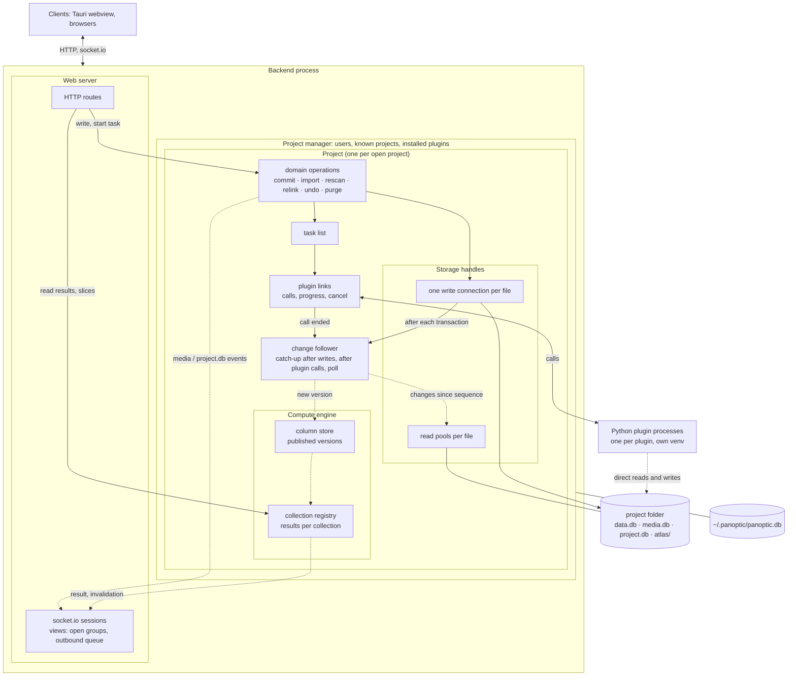

# opti: specification of the Rust backend

The backend is rewritten in Rust for speed. Plugins stay in Python, so they stay easy to write.
The collection compute (filter, sort, group, piles, clusters, selection) moves from the webview
to the backend, and the front renders slices of the results instead of holding every column.

The backend is one process with four blocks, plus the plugins that talk to it. The **Project**
block is the hub: one instance per open project, it owns that project's storage handles, its
engine, its tasks and its plugin processes, and every write goes through it.

| block | role | notes |
|---|---|---|
| **Project** | one per open project, opened and closed by a small install-level manager (`panoptic.db`, the list of open projects). Opens the project (connection pools, tombstone purge, first load, `on_project_open`). Holds the domain operations (commit, import, rescan, relink, undo/redo, purge), so it is the only source of the backend's writes, and triggers the store's catch-up after each one. Owns the task list and the plugin processes. Sends changes out: new store versions to the engine, `media.db` / `project.db` changes to the web server as events | [00](00-project.md) lifecycle, writes, change follower, events, tasks, plugin processes |
| **Storage** | the project's persistent state: `data.db` (annotations), `media.db` (thumbnails, vectors, maps), `project.db` (tabs, settings) and the install's `panoptic.db` (users, projects, plugins). Files, schema, connections and the rules every writer follows, with no behaviour of its own: the change feed (`sequence`) is read by the Project, not pushed by Storage | [01](01-sqlite-layout.md) data.db, [02](02-storage.md) the other files and access rules, [03](03-elements.md) images, files and instances, [04](04-moves-and-deletions.md) rescans, moves and deletions |
| **Compute engine** | owned by the Project: one column store per project, loaded once and shared by every collection, and the registry of collections. Many collections compute in parallel, and each tab or view asks for its own tree. Computes over a store version, never writes | [05](05-column-store.md) column store, [06](06-collection-manager.md) collections and their API, [07](07-slice-sending.md) §7 many collections on one backend |
| **Web server** | the translation between the outside and the Projects: serves the web UI and the HTTP API, and keeps the socket.io sessions and views that receive tree slices and change events. Holds no project state beyond sessions and views: a route calls the Project (to write, start a task) or reads the engine's published results | [07](07-slice-sending.md) §2–§6 slices, seeking, invalidation, [08](08-web-server.md) routes, sessions, change events |
| **Python plugins** | run in their own process, one per plugin, started and stopped by the Project. When the Project runs one of their functions (as a task), they read and write the db files directly, through a Python plugin API. They read the data as it is at that moment and get no live updates | [09](09-plugins.md) |

## Who owns what

Boxes inside a box are owned by it (created, kept alive, closed with it). Solid arrows are
calls, dashed arrows are data moving.

| note | content |
|---|---|
| [00-project.md](00-project.md) | the hub of one open project: project manager, folder lock, open and close, domain operations, change follower, events, tasks, plugin processes and hooks |
| [01-sqlite-layout.md](01-sqlite-layout.md) | the data.db layout: the full schema (typed values, property-first keys, image ids, subimages, scan state, tombstones) and the rules every writer follows |
| [02-storage.md](02-storage.md) | media.db, project.db, panoptic.db; ids, connections, locks, who writes what |
| [03-elements.md](03-elements.md) | images, files and instances: the three levels, which one holds which values, row kinds in the engine |
| [04-moves-and-deletions.md](04-moves-and-deletions.md) | rescans, missing files, relinks, content changes, purge |
| [05-column-store.md](05-column-store.md) | the column store: loading from data.db, applying deltas, notifying changes; consistency, targets, acceptance tests |
| [06-collection-manager.md](06-collection-manager.md) | the backend collection manager: API, performance strategy, implementation plan |
| [07-slice-sending.md](07-slice-sending.md) | tree slices: the UI requests pieces of the resulting tree and builds its own lines; caching, seeking, invalidation, many collections on one backend |
| [08-web-server.md](08-web-server.md) | deployments, HTTP API, socket.io sessions, change events |
| [09-plugins.md](09-plugins.md) | plugin processes, calls and hooks, the Python plugin API and how its writes reach the files |

Out of scope for now: migrating existing projects to the new format.

Sources: the data formats the Python backend writes today
(`panoptic_back/panoptic/core/databases/`), the front's TS code as the reference behaviour, and
the measurements of [`bench/collection`](../bench/collection/README.md) (compute, memory and
wire, 1M synthetic images).

Conventions: one note per subject, numbered in block order (Project 00, Storage 01–04, Compute
engine 05–07, Web server 08, Python plugins 09), dated status line at the top.
When today's code and a note disagree on existing behaviour, fix the note.
